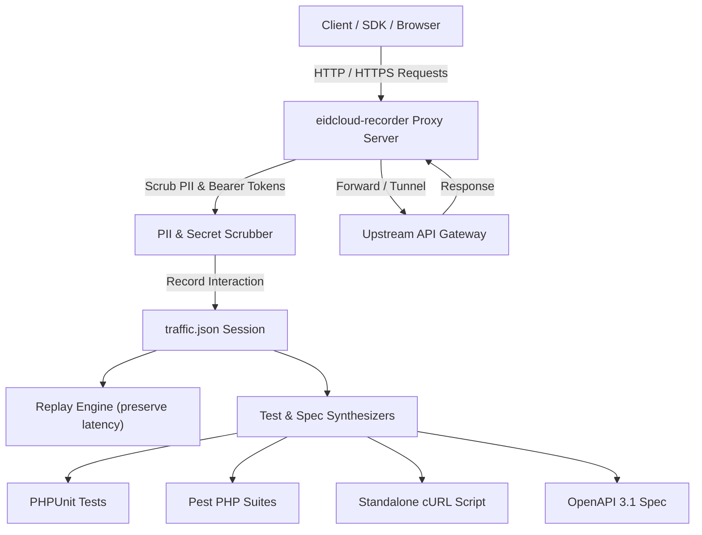

[🇸🇦 العربية](README.ar.md) | [🇬🇧 English](README.md)

# 📼 eidcloud-http-recorder

> Lightweight HTTP traffic recorder, replay engine, and automated mock/test synthesizer in pure PHP 8.2+ with zero external vendor dependencies.

[](https://github.com/eidcloud/eidcloud-http-recorder)
[](https://www.php.net/)
[](LICENSE)
[](https://colab.research.google.com/github/eidcloud/eidcloud-http-recorder/blob/main/notebooks/quickstart.ipynb)

---

## 📑 Overview

`eidcloud-http-recorder` is a pure PHP, dependency-free alternative to proxy inspection tools like *mitmproxy* or *WireMock*. It captures HTTP and HTTPS requests, redacts sensitive PII (bearer tokens, passwords, credit card numbers, API keys), replays recorded traffic against local or staging environments with original latency characteristics, and synthesizes ready-to-run **PHPUnit** and **Pest** mock test suites, executable **cURL** validation scripts, and reverse-engineered **OpenAPI 3.1** specifications.



---

## ✨ Features

- **Zero Vendor Dependencies:** 100% pure PHP 8.2+ standard library (`ext-curl`, `ext-sockets`, `ext-json`).
- **Full Traffic Recording:** Intercepts headers, request bodies, response payloads, query parameters, HTTP status codes, and microsecond timings.
- **Automated PII & Secret Scrubbing:** Sanitizes passwords, JWTs, bearer tokens, API keys, cookies, and credit card patterns from headers, JSON bodies, form fields, and query strings.
- **Replay Engine:** Replays recorded session flows against custom target hosts with configurable latency simulation and playback multipliers.
- **Automated Test Synthesizer:**
  - Converts recorded traffic into **PHPUnit** test fixtures and test cases.
  - Generates ready-to-run **Pest PHP** tests.
  - Produces standalone executable **cURL test scripts** for CI/CD smoke testing.
- **OpenAPI 3.1 Inference:** Reverse-engineers OpenAPI 3.1 schemas with deep JSON type inference from live captured payloads.
- **Interactive CLI:** Built-in `bin/eidcloud-recorder` command-line utility.

---

## 🚀 Installation

### Via Composer
```bash
composer require eidcloud/http-recorder
```

### Standalone / Git Clone
Clone directly without needing any `composer install`:
```bash
git clone https://github.com/eidcloud/eidcloud-http-recorder.git
cd eidcloud-http-recorder
```

---

## 🛠️ CLI Usage

The bundled CLI executable `bin/eidcloud-recorder` provides complete control over recording, replaying, and generating tests:

### 1. Record Live Traffic
Start the proxy recorder on port 8888 and save captured sessions:
```bash
php bin/eidcloud-recorder record --port=8888 --out=traffic.json
```

To run as a reverse proxy targeting an existing API:
```bash
php bin/eidcloud-recorder record --port=8080 --target=https://api.example.com --out=traffic.json
```

### 2. Replay Traffic
Replay recorded requests against a local development server:
```bash
php bin/eidcloud-recorder replay traffic.json --target=http://localhost:8000
```

Replay preserving original response latencies:
```bash
php bin/eidcloud-recorder replay traffic.json --target=http://localhost:8000 --latency --speed=1.5
```

### 3. Synthesize Tests & OpenAPI Specifications
Generate PHPUnit, Pest, cURL runners, and OpenAPI 3.1 schemas from recorded sessions:
```bash
php bin/eidcloud-recorder export-tests traffic.json --out=./tests/Generated/
```

### 4. Session Statistics
View recorded session metrics and endpoint breakdown:
```bash
php bin/eidcloud-recorder stats traffic.json
```

---

## 💻 Programmatic PHP API

### Intercept & Record
```php
use EidCloud\HttpRecorder\HttpRecorder;
use EidCloud\HttpRecorder\Model\RecordedInteraction;

$recorder = new HttpRecorder('traffic.json', autoScrub: true);

$recorder->record(new RecordedInteraction(
    id: uniqid('req_', true),
    timestamp: microtime(true),
    method: 'POST',
    uri: 'https://api.example.com/v1/auth/login',
    requestHeaders: ['Authorization' => 'Bearer secret-key-xyz', 'Content-Type' => 'application/json'],
    requestBody: json_encode(['username' => 'alice', 'password' => 'secret_pass']),
    statusCode: 200,
    responseHeaders: ['Content-Type' => 'application/json'],
    responseBody: json_encode(['token' => 'jwt_xyz']),
    durationMs: 35.4
));
```

### Synthesize Tests
```php
$generator = $recorder->getTestGenerator();

// PHPUnit
$phpunitCode = $generator->generatePhpUnit('AuthServiceTest');
file_put_contents('tests/AuthServiceTest.php', $phpunitCode);

// OpenAPI 3.1 Spec
$openApiSpec = $generator->generateOpenApiSpec('Captured Auth API', '1.0.0');
file_put_contents('openapi.json', json_encode($openApiSpec, JSON_PRETTY_PRINT));
```

---

## 🧪 Running Tests

The test suite runs with zero third-party dependencies:
```bash
php tests/run_tests.php
```

---

## 👤 Author & Maintainer

**Eng. MHD. Shadi AL-Hasan**  
- **Role:** Executive CTO & Enterprise Solutions Architect  
- **Email:** [mhd.shadi.alhasan@gmail.com](mailto:mhd.shadi.alhasan@gmail.com)  
- **Phone / WhatsApp:** [+963934005922](tel:+963934005922)  
- **Location:** Damascus, Syria  
- **GitHub:** [shadialhasan](https://github.com/shadialhasan)  

---

## 📄 License

This project is licensed under the MIT License - see the [LICENSE](LICENSE) file for details.  
Copyright (c) 2026 **MHD. Shadi AL-Hasan**. All rights reserved.
